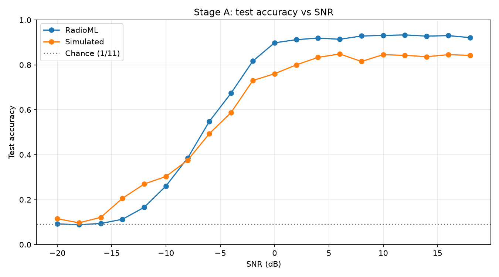
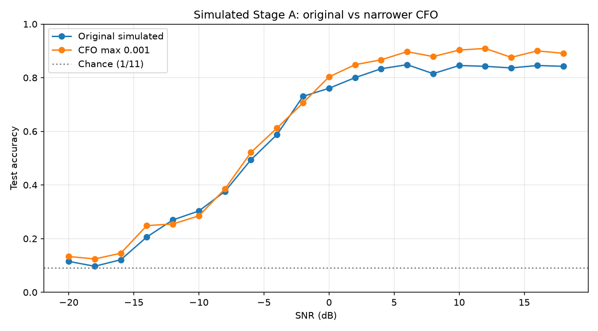
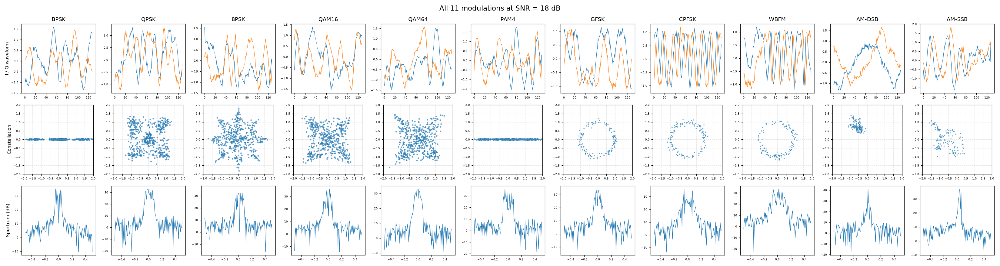
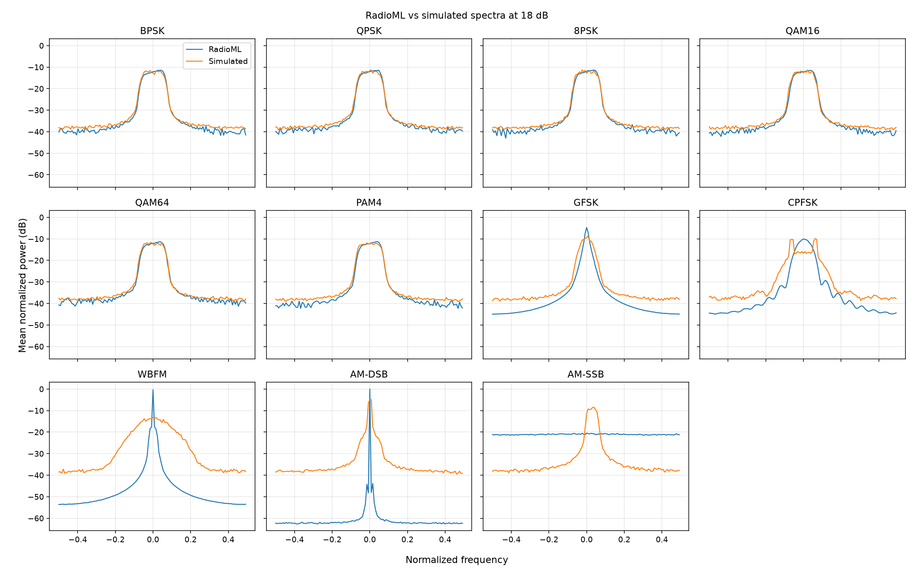
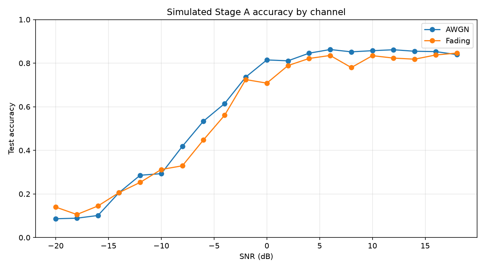

# AI-Powered Wireless Signal Analyzer

A student project for generating and exploring wireless I/Q signals, preparing
them for machine learning, and recognizing their modulation type with a
convolutional neural network (CNN).

The current machine-learning milestone is **Stage A: modulation recognition**.
It compares a simulated dataset with RadioML 2016.10A and includes an additional
experiment that reduces the simulated carrier-frequency-offset (CFO) range.

> **Current scope:** Stage A predicts one of 11 known modulation classes. The
> project also creates anomaly labels and an optional SNR output head, but
> anomaly detection and SNR regression are not trained in Stage A.

## Contents

- [Project at a glance](#project-at-a-glance)
- [Architecture and workflow](#architecture-and-workflow)
- [Project structure](#project-structure)
- [Datasets and labels](#datasets-and-labels)
- [Results so far](#results-so-far)
- [Setup](#setup)
- [How to use the project](#how-to-use-the-project)
- [Tools and libraries](#tools-and-libraries)
- [Limitations and next steps](#limitations-and-next-steps)

## Project at a glance

The project works with short baseband wireless signal frames. Each frame has
128 complex samples represented as two rows:

- Row 0: in-phase samples (**I**)
- Row 1: quadrature samples (**Q**)

The model receives a batch shaped `(batch_size, 2, 128)` and predicts the
signal's modulation class. The 11 classes are:

`BPSK`, `QPSK`, `8PSK`, `QAM16`, `QAM64`, `PAM4`, `GFSK`, `CPFSK`, `WBFM`,
`AM-DSB`, and `AM-SSB`.

The project has two main data sources:

1. **Simulated signals**, produced by this repository's Python signal
   simulator. These include modulation, SNR, channel, and anomaly labels.
2. **RadioML 2016.10A**, converted from its downloaded pickle file into the
   same basic I/Q, modulation, SNR, and split format.

## Architecture and workflow

```text
                           ┌─────────────────────────────┐
                           │    Signal sources           │
                           │                             │
                           │ Python simulator  RadioML   │
                           └──────────┬──────────┬───────┘
                                      │          │
                         build_dataset.py  import_radioml.py
                                      │          │
                                      └─────┬────┘
                                            v
                             Clean, normalized, labeled NPZ
                              (I/Q, modulation, SNR, split)
                                            │
                     ┌──────────────────────┴─────────────────────┐
                     v                                            v
          validate_and_plot.py                         dataset_loader.py
          checks and dataset graphs                     train/val/test data
                                                                  │
                                                                  v
                                                        train.py + model.py
                                                                  │
                                                best checkpoint selected on validation
                                                                  │
                                                                  v
                                                  evaluate test split once
                                                                  │
                                                                  v
                              accuracy-by-SNR, confusion matrix, summary and plots
```

### What happens in the pipeline

1. **Generate or import signals**
   - `simulator.py` creates modulated signals and applies channel effects.
   - `build_dataset.py` generates the simulated dataset.
   - `import_radioml.py` converts the RadioML pickle.
2. **Clean and prepare frames**
   - Invalid and zero-power frames are removed.
   - Each kept frame is normalized to unit average power.
   - Data is split into training, validation, and test partitions.
3. **Check and explore the data**
   - `validate_and_plot.py` runs integrity checks and creates dataset graphs.
   - `compare_datasets.py` compares signal spectra and amplitude kurtosis
     between RadioML and simulated signals.
4. **Train Stage A**
   - `model.py` defines the 1D CNN.
   - `train.py` trains on the training split, uses validation loss to select
     the best checkpoint, then evaluates the test split after training.
   - During training, each frame receives a random phase rotation. This
     represents a change in carrier phase without changing its power.
5. **Compare experiments**
   - `compare_results.py` combines the RadioML and original simulated results.
   - `compare_cfo_results.py` compares the original simulated run with the
     narrower-CFO experiment.
   - `analyze_extra.py` and `analyze_extra2.py` create additional test-set
     breakdowns.

### CNN in simple terms

The network applies several 1D convolution and residual-block stages to learn
patterns in the I/Q samples. Max-pooling reduces the time dimension. Global
average and maximum pooling summarize the learned features, which are passed
to a final classification layer with 11 outputs. The model has approximately
**220,427 parameters**.

An optional SNR head is present in the model definition for future work. The
Stage A trainer uses the modulation head only.

## Project structure

```text
project/
├── simulator.py                   # Signal generators and channel effects
├── build_dataset.py               # Generate, clean, label, split simulated data
├── import_radioml.py              # Convert the RadioML pickle to NPZ
├── dataset_loader.py              # Load train/validation/test partitions
├── validate_and_plot.py           # Dataset checks, statistics and plots
├── compare_datasets.py            # RadioML-versus-simulated signal comparison
├── model.py                       # 1D CNN and residual blocks
├── train.py                       # Stage A training and test evaluation
├── compare_results.py             # Combine RadioML and simulated Stage A results
├── analyze_extra.py               # Low-SNR class and channel analyses
├── analyze_extra2.py              # Low-SNR prediction counts and precision
├── compare_cfo_results.py         # Original-versus-low-CFO result comparison
├── requirements.txt               # Python package requirements
├── data/                           # Input datasets, generated data and metadata
├── plots/                          # Dataset and signal-comparison graphs
├── results/                        # Checkpoints, logs, reports and model graphs
└── tests/
    └── test_stageA.py              # Stage A model and data-split tests
```

### Important data files

| File | Description |
|---|---|
| `data/signal_dataset.npz` | Main simulated dataset (the default CFO setting). |
| `data/dataset_info.json` | Metadata for the main simulated dataset. |
| `data/labels.csv` | Human-readable labels for the main simulated dataset. |
| `data/RML2016.10a_dict.pkl` | RadioML source pickle, if supplied locally. |
| `data/radioml_2016a.npz` | Converted RadioML frames and labels. |
| `data/radioml_info.json` | Import information and raw RadioML power statistics. |
| `data/signal_dataset_cfo0001.npz` | Simulated dataset generated with `--cfo-max 0.001`. |
| `data/signal_dataset_cfo0001_info.json` | Metadata for the low-CFO dataset. |
| `data/signal_dataset_cfo0001_labels.csv` | Human-readable low-CFO dataset labels. |
| `data/dataset_statistics.json` | Statistics written by the dataset validation/plot script. |
| `data/comparison.json` | Numeric results from the RadioML-versus-simulated comparison. |

### Important result files

Each trained run has its own directory under `results/`, for example:
`results/radioml_stageA/`, `results/simulated_stageA/`, and
`results/simulated_cfo0001/`.

Typical run outputs include:

- `best_model.pt` — weights from the epoch with the best validation loss.
- `history.json` and `train_log.txt` — epoch metrics and console output.
- `summary.json` — overall and per-SNR test metrics.
- `accuracy_vs_snr.csv` and `accuracy_vs_snr.png` — test accuracy by SNR.
- `loss_curve.png` — training and validation losses.
- `confusion_matrix_snr_ge_10.png` — high-SNR test confusion matrix.

Additional reports and plots are listed in [Results so far](#results-so-far).

## Datasets and labels

### Simulated dataset

The standard simulated dataset contains **51,500 frames**:

- 44,000 normal modulation frames: 11 modulations × 20 SNR values × 2 channels
  × 100 frames.
- 7,500 anomaly frames: five anomaly types × 1,500 frames.
- SNR values range from **−20 dB to +18 dB in 2 dB steps**.
- Channels are AWGN (with carrier/phase offset) and 3-tap Rayleigh fading.
- I/Q frames are stored as float32 arrays with shape `(N, 2, 128)`.

The five generated anomaly types are `jamming_tone`, `clipping`,
`impulsive_noise`, `unknown_ofdm`, and `unknown_chirp`. Stage A filters to
normal examples with a known modulation label; it does not train an anomaly
classifier.

### RadioML dataset

RadioML 2016.10A is supplied as a dictionary keyed by modulation and SNR. The
converter validates the keys and frame shapes, drops invalid or zero-power
frames, normalizes the remaining frames, and creates a stratified split. The
converted file contains **220,000 frames**, split into **154,000 training**,
**33,000 validation**, and **33,000 test** frames.

RadioML does not include this project's channel or anomaly labels. The loader
marks the channel as unavailable and provides default non-anomaly values for
those fields.

### Common labels and split values

| Field | Meaning |
|---|---|
| `X` | I/Q samples, shape `(N, 2, 128)`, float32 |
| `mod` | Modulation class ID from 0 to 10; `-1` means unknown |
| `snr` | Signal-to-noise ratio in dB |
| `split` | `0` = train, `1` = validation, `2` = test |
| `channel` | `0` = AWGN, `1` = fading, `-1` = unavailable |
| `anomaly` | `0` = normal, `1` = anomaly |
| `anomaly_type` | Anomaly type ID; `0` means no anomaly |
| `quality` | `0` = poor, `1` = fair, `2` = good |

For Stage A training on simulated data, normal frames with a known modulation
are retained. This results in 30,800 training, 6,600 validation, and 6,600
test frames for the supplied default simulated dataset.

## Results so far

### Stage A test accuracy

These values are from the generated run summaries. Both original runs used
seed 2026 and were trained for 20 epochs on CPU.

| Dataset | Overall accuracy | SNR ≥ 10 dB | SNR < 0 dB | Test frames |
|---|---:|---:|---:|---:|
| RadioML | 62.28% | 92.87% | 32.39% | 33,000 |
| Simulated (default CFO) | 57.85% | 84.24% | 33.00% | 6,600 |
| Simulated (CFO max 0.001) | 60.94% | 89.58% | 34.15% | 6,600 |

The per-SNR values and training details for the original RadioML and simulated
runs are in [`results/stageA_summary.md`](results/stageA_summary.md). The
additional low-CFO comparison is in
[`results/simulated_cfo0001_comparison.md`](results/simulated_cfo0001_comparison.md).
The smaller low-SNR, prediction-distribution, and channel reports are:

- [`results/stageA_per_class_low_snr.md`](results/stageA_per_class_low_snr.md)
- [`results/stageA_prediction_distribution.md`](results/stageA_prediction_distribution.md)
- [`results/stageA_simulated_by_channel.md`](results/stageA_simulated_by_channel.md)

The model's accuracy generally improves as SNR increases. The figures above are
specific to the saved datasets, checkpoints, and training runs; a new run may
produce different values.

### Accuracy-versus-SNR comparison



The full per-SNR table is in
[`results/stageA_summary.md`](results/stageA_summary.md).

### Original simulated data versus lower CFO

The CFO experiment changes the maximum absolute CFO from the default **0.01**
to **0.001** of the sample rate. The confusion counts below combine both
directions for each class pair and use normal, known-modulation test frames at
SNR ≥ 10 dB across both channels.

| Confused class pair | Default CFO | CFO max 0.001 |
|---|---:|---:|
| QPSK ↔ 8PSK | 92 | 12 |
| QAM16 ↔ QAM64 | 141 | 139 |

There were 1,650 test frames in the SNR ≥ 10 dB group for each run. See the
[CFO comparison report](results/simulated_cfo0001_comparison.md) for the
accuracy-by-SNR table.



### Dataset and signal graphs

The following graphs are generated by the dataset validation and comparison
scripts:

| Graph | What it shows |
|---|---|
| `plots/01_distributions.png` | Dataset label and SNR distributions. |
| `plots/02_modulation_gallery.png` | Example signals from the modulation classes. |
| `plots/03_snr_effect_qpsk.png` | Example QPSK signal at different SNR values. |
| `plots/04_anomaly_examples.png` | Examples of generated signal anomalies. |
| `plots/05_feature_sanity_check.png` | Signal feature sanity checks. |
| `plots/06_spectra_radioml_vs_ours.png` | Average spectra by modulation, comparing RadioML and simulated data. |
| `plots/07_kurtosis_vs_snr.png` | Amplitude kurtosis by SNR for selected modulations. |
| `plots/radioml_qpsk_18db.png` | A RadioML QPSK example at 18 dB. |
| `results/stageA_simulated_by_channel.png` | Simulated test accuracy by channel and SNR. |

#### Example I/Q signal and channel comparison







## Setup

The commands below are for **Windows PowerShell**. Run them from the
repository's top-level folder. Python and Git must be installed. A CUDA-capable
GPU is optional; PyTorch uses it when available and otherwise runs on CPU.

Create and activate a virtual environment, then install the packages:

```powershell
py -m venv .venv
.\.venv\Scripts\Activate.ps1
python -m pip install --upgrade pip
python -m pip install -r requirements.txt
```

If PowerShell blocks environment activation, run the commands directly with
the virtual environment's interpreter instead:

```powershell
.\.venv\Scripts\python.exe -m pip install -r requirements.txt
.\.venv\Scripts\python.exe validate_and_plot.py
```

The project uses NumPy, SciPy, Matplotlib, PyTorch, and pytest. The repository
already contains the converted datasets and model results described above. You
do not need to rebuild or retrain them just to view the reports and graphs.

## How to use the project

### 1. Check the included simulated dataset

```powershell
python validate_and_plot.py
python dataset_loader.py
```

The validation script prints data checks and creates or refreshes dataset
statistics and plots. The loader script prints the split sizes. It validates
the standard simulated dataset.

### 2. Load a split in Python

```python
from dataset_loader import load_dataset

train = load_dataset("train")  # simulated dataset
X = train["X"]                 # float32, shape (N, 2, 128)
modulation = train["mod"]
snr_db = train["snr"]

radio_test = load_dataset("test", dataset="radioml")
```

Use `"train"`, `"val"`, `"test"`, or `"all"` as the split. For the simulated
dataset, `normal_only=True` filters out anomaly examples:

```python
normal_train = load_dataset("train", normal_only=True)
```

### 3. Convert a RadioML pickle (optional)

If you have the original RadioML file, put it in `data/` or provide its path:

```powershell
python import_radioml.py data\RML2016.10a_dict.pkl
```

This writes `data/radioml_2016a.npz` and `data/radioml_info.json`.

### 4. Compare the two source datasets

```powershell
python compare_datasets.py
```

This writes numeric results to `data/comparison.json` and creates the
RadioML-versus-simulated spectra and kurtosis plots in `plots/`.

### 5. Train Stage A

The trainer's default dataset is RadioML. The example below uses the included
simulated dataset, runs one epoch as a quick smoke test, and writes into its
own output folder:

```powershell
python train.py --data data\signal_dataset.npz --epochs 1 --seed 2026 --tag smoke
```

For a full 20-epoch simulated run:

```powershell
python train.py --data data\signal_dataset.npz --epochs 20 --seed 2026 --tag simulated_stageA
```

For RadioML:

```powershell
python train.py --data data\radioml_2016a.npz --epochs 20 --seed 2026 --tag radioml_stageA
```

Useful options include `--batch`, `--lr`, `--wd`, `--patience`, and `--tag`.
Run `python train.py --help` for defaults and descriptions. Training uses
validation loss for checkpoint selection and early stopping. The test split
is evaluated after training and selection are complete. Do not reuse a tag if
you want to keep its existing artifacts.

### 6. Compare, analyze, and test

```powershell
python compare_results.py
python analyze_extra.py
python analyze_extra2.py
pytest -q
```

These scripts use saved checkpoints and test splits; they do not retrain the
models. `compare_results.py` creates the combined RadioML/simulated report and
plot. The analysis scripts create extra per-class, per-channel, and prediction
distribution reports.

### 7. Reproduce the lower-CFO experiment (optional)

The simulator's default CFO maximum is `0.01`. A non-default value writes
separate dataset, label, and metadata files, so the standard
`data/signal_dataset.npz`, `data/labels.csv`, and `data/dataset_info.json`
remain unchanged.

```powershell
python build_dataset.py --cfo-max 0.001 --seed 2026
python train.py --data data\signal_dataset_cfo0001.npz --epochs 20 --seed 2026 --tag simulated_cfo0001
python compare_cfo_results.py
```

The generated files are:

- `data/signal_dataset_cfo0001.npz`
- `data/signal_dataset_cfo0001_labels.csv`
- `data/signal_dataset_cfo0001_info.json`

The comparison script writes
`results/simulated_cfo0001_comparison.md` and
`results/simulated_cfo0001_accuracy_vs_snr.png`.

## Tools and libraries

| Tool or library | How it is used |
|---|---|
| Python | Project language and experiment scripts. |
| NumPy | Signal arrays, dataset operations, metrics, and splitting. |
| SciPy | Signal-processing utilities used by the signal pipeline. |
| PyTorch | CNN definition, training, checkpointing, and inference. |
| Matplotlib | Dataset, training, and result plots. |
| pytest | Automated tests for Stage A model and data-split behavior. |
| Git | Version control for the project. |

GNU Radio is part of the project's inspiration, but the current signals are
generated by the included Python simulator; installing GNU Radio is not
required to run the included pipeline.

## Limitations and next steps

- Stage A is a modulation classifier; it is not yet a trained anomaly detector.
- The optional SNR regression head exists but is not used by Stage A training.
- Simulated analog modulations use generated band-limited messages rather than
  real speech or music.
- Simulated channel effects are simplified and do not model all real radio
  hardware impairments.
- RadioML and simulated data come from different signal-generation processes,
  so their metrics should be interpreted as a comparison, not as identical
  test conditions.
- The lower-CFO experiment improves some measured metrics and confusion counts,
  but it is one controlled run with a fixed seed, not proof that lower CFO is
  always better in real deployments.

Possible next stages include SNR estimation, anomaly detection, testing across
more seeds and channel settings, and evaluation on additional real-world data.
